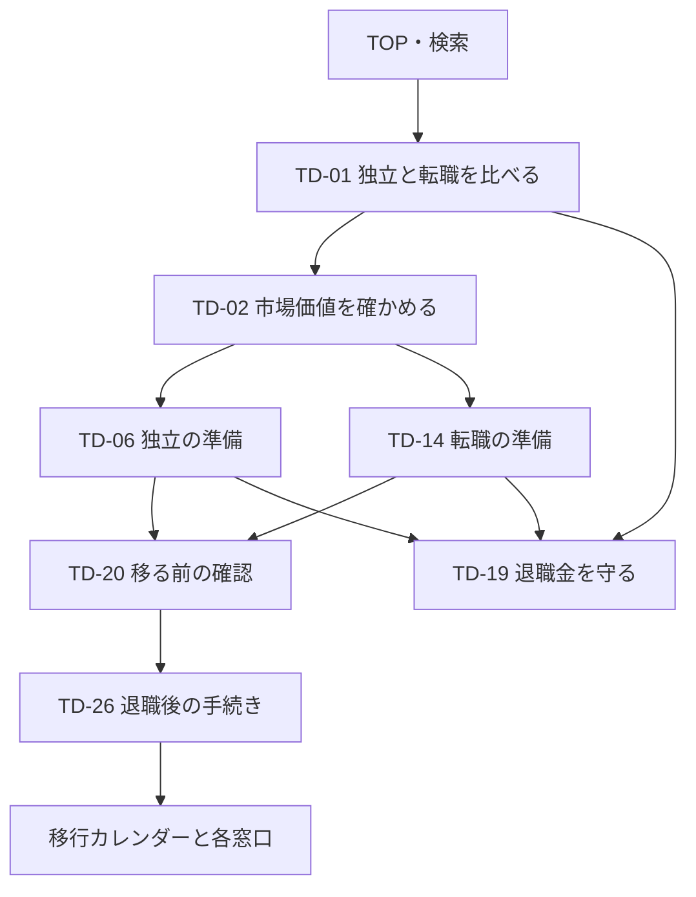

# 独立か、転職か。 サイト設計書 v1.0

作成日：2026年10月12日  
基準資料：[企画書 v2.2](../独立か、転職か。%20企画書%20v2.2.md) §1・4〜11・13〜15  
関連資料：[カテゴリ・タグ定義](カテゴリ・タグ定義.md)／[記事リスト](記事リスト.md)

本書はサイト構造と編集運用の設計案。記事本文、Webサイト、移行カレンダーの実装・公開は次の工程とする。企画書の30記事を保持し、記事番号をTD-01〜TD-30として追跡する。

## 1. サイトが果たす役割

**50代からの次の働き方を、比べて、選んで、準備する。**

対象は早期退職・役職定年をきっかけに会社の外での働き方を考える管理職・専門職。独立と転職を同じ比較軸で扱い、経験を次の仕事に移す実務と、退職金を守る確認事項を提供する。

| 読者 | 最初の入口 | 読後にできること |
| --- | --- | --- |
| S1：早期退職を機に次を考えている | 比較のハブTD-01／準備のハブTD-20 | 独立と転職の違い、退職日までに確認する事項が分かる |
| S2：役職定年を前に情報収集中 | 比較TD-01／市場価値TD-02／独立手順TD-06 | 経験の需要を確かめ、小さく試す準備ができる |
| S3：方向を決めて準備中 | 独立TD-06／転職TD-14／手続きTD-26 | 次の行動と窓口への確認事項が分かる |

公務員、完全引退だけを望む人、許認可業種の開業、会社に残るかだけの判断は初期対象に含めない。適職診断、個別の税額・給付額・採算を判定する機能は作らない。

## 2. 情報構造とURL

記事は1つの主カテゴリに所属する。カテゴリは読者が進む道筋、タグは道筋を横断する具体的なテーマとする。「体験談・アンケート」「退職金を守る」は編集テーマの一覧ページであり、6つ目・7つ目の主カテゴリにはしない。

```text
TOP /
├ 独立と転職を比べる /category/compare/
│  └ ハブ TD-01、TD-02〜05、TD-19
├ 独立する /category/independence/
│  └ ハブ TD-06、TD-07〜13
├ 転職する /category/career-change/
│  └ ハブ TD-14、TD-15〜18
├ 移る前の準備 /category/before-leaving/
│  └ ハブ TD-20、TD-21〜25
├ 退職後の手続き /category/after-leaving/
│  └ ハブ TD-26、TD-27〜30
├ 移行カレンダー /tools/transition-calendar/
├ 体験談・アンケート /stories/
├ 退職金を守る /guides/protect-retirement-money/
├ 全記事 /articles/ → 記事詳細 /articles/{slug}/
├ 検索 /search/
├ テーマ一覧 /tags/ → テーマ詳細 /tags/{tag-id}/
└ 運営者情報・編集方針・免責・広告方針・個人情報・問い合わせ
```

ドメインは未確定。URL例はパスのみで定義する。記事URLにカテゴリ名を入れず、カテゴリを変更しても記事URLを維持できるようにする。表示名を変えてもslugと記事IDは維持する。

## 3. ページ一覧と公開条件

| ページ | URL | 役割・内容 | 公開条件 |
| --- | --- | --- | --- |
| トップ | `/` | 3つの入口、カレンダー、独立と転職の準備、退職金を守る記事 | 固定ページと最初のハブ公開後 |
| カテゴリ一覧 | `/category/` | 5つのカテゴリの対象と読み方 | 公開記事があるカテゴリだけリンクする |
| カテゴリ詳細×5 | `/category/{id}/` | ハブ、読む順番、テーマ別記事一覧、次の行動 | 対応ハブ公開後 |
| 全記事・ページ送り | `/articles/` | 新着順。カテゴリ・タグの絞り込みへの入口 | 最初の記事公開後 |
| 記事詳細×30 | `/articles/{slug}/` | 対象・要点・根拠・確認日・本文・次の行動 | 各記事の確認を完了したものだけ |
| 検索 | `/search/` | タイトル・概要・本文・タグを検索 | 公開記事だけを索引に含める |
| 移行カレンダー | `/tools/transition-calendar/` | 条件入力、日付入り一覧、解説記事、カレンダー追加 | 対応ルールと制度記事の確認完了後 |
| 体験談・アンケート | `/stories/` | 独立・転職の声、調査方法、対象と実施日 | TD-05または実取材が完成するまでは非公開 |
| 退職金を守る | `/guides/protect-retirement-money/` | TD-19を起点に、TD-11・12・23・25を読む案内 | TD-19と関連記事が公開後。初期はTD-19への直リンクで代替可能 |
| タグ一覧・詳細 | `/tags/`・`/tags/{id}/` | 横断テーマの絞り込み | 少数記事のページは検索索引対象外。詳細は分類定義を参照 |
| 運営者情報 | `/about/` | 運営主体、編集者の立場、連絡方法、類似書籍と無関係であること | 初回公開時 |
| 編集方針 | `/editorial-policy/` | 一次情報、比較基準、更新・訂正、取材方法 | 初回公開時 |
| 免責事項 | `/disclaimer/` | 情報の範囲、個別判断をしないこと、確認窓口 | 初回公開時 |
| 広告掲載ポリシー | `/disclosure/` | 広告関係、掲載・比較基準、扱わない商材 | 初回公開時 |
| プライバシーポリシー | `/privacy/` | 問い合わせ・アクセス解析・カレンダーの入力情報の扱い | 実際の運用に合わせて初回公開時 |
| 問い合わせ | `/contact/` | 訂正連絡、取材、広告の連絡窓口 | 有効な送信先または連絡先を設定して公開 |
| 404 | 存在しないパス | トップ・検索・5カテゴリへの案内 | 初回公開時 |

編集方針・免責は独立したページとして検索・共有できるようにする。実装負担を減らす場合は運営者情報内の明確な節にまとめ、固定のアンカーリンクで案内してよい。無内容の一覧、準備中の記事へのリンクは公開しない。

## 4. ナビゲーション

PCはサイト名、5カテゴリ、検索、移行カレンダーを表示する。棚の短い表記は「比べる／独立する／転職する／移る前の準備／退職後の手続き」。正式なカテゴリ名は一覧見出しとパンくずで使う。

スマートフォンはサイト名・検索・メニューを上部に置き、メニューに同じ5カテゴリとカレンダーを入れる。独立と転職は同じ階層・同じ大きさで表示する。フッターには全記事、体験談、運営・編集・免責・広告・プライバシー・問い合わせを置く。体験談の公開前はそのリンクを隠す。

パンくずは「TOP → 主カテゴリ → 記事」。タグは補助リンクとして表示し、パンくずに含めない。

## 5. トップページの構成

| 順序 | 要素 | コピー・内容 | 行き先 |
| --- | --- | --- | --- |
| 1 | ヒーロー | **会社の外で働くか、次の会社で働くか。**／早期退職・役職定年のあと、50代からの次の働き方を比べて準備するメディア | 主CTA「退職予定日から、移行カレンダーを作る」。副CTA「独立と転職を比べる」 |
| 2 | 3つの入口 | 「独立を考えている」「転職を考えている」「まだ決めていない」 | 順にTD-06、TD-14、TD-01 |
| 3 | 独立と転職の準備 | 独立：経験・顧問・業務委託／転職：職務経歴・サービス・求人条件 | B・Cを同じ面積、各3記事で表示 |
| 4 | 移る前後の確認 | 退職前の確認リスト／退職後の手続き一覧 | TD-20／TD-26／カレンダー |
| 5 | 退職金を守る | 勧誘・総費用・契約・生活の見通しを確認する | TD-19とTD-25。独立を勧める広告の見せ方にしない |
| 6 | 体験談・アンケート | 選んだ理由と、その後。独立・転職の声を並べる | TD-05・将来の取材記事。未実施の間は枠ごと非表示 |
| 7 | はじめに読む記事 | 初期は編集部選定のハブ・主要記事。十分なアクセス集計後に人気記事へ変更 | 公開済み記事だけ |
| 8 | メディアの立場 | 比べる基準、退職金を守る立場、編集者として調べて整理すること | 運営者情報・編集方針 |

カレンダー公開前は主CTAを「移る前の確認リストを読む」へ変更しTD-20に案内する。「人気記事」を実測なしで掲げない。冒頭からアフィリエイトの申込みを主導線にしない。

## 6. カテゴリページと記事ページ

カテゴリページは「このカテゴリで分かること → 最初に読むハブ → 読む順番 → テーマ別の記事 → 次のカテゴリ・カレンダー」の順とする。カテゴリ説明だけの薄い一覧にせず、ハブは比較・手順を説明する本文を持つ。カテゴリは記事を探すための一覧、ハブは全体を理解するための記事として役割を分ける。

独立カテゴリのグループ見出しは「経験を仕事にする」「在職中に試す」「別の独立方法を確認する」「開業の実務」。フランチャイズ・M&Aを、顧問・業務委託より先に押し出さない。転職カテゴリは「動き始める」「サービスを選ぶ」「経験と条件を伝える」。D・Eは「退職前／直後／入社・開業／翌年度」の順序と条件を明示する。

記事ページは次の共通構成にする。

1. パンくず、主カテゴリ、タイトル、対象、公開日・更新日。広告を含む場合は冒頭にPR表示。
2. この記事で分かること、対象者と扱う範囲、3つ以内の要点。
3. 目次、本文の比較表・手順・確認リスト。制度は対象・条件・起算日・窓口を同じ箇所で示す。
4. 制度の最終確認日、一次情報へのリンク、編集者の確認担当・次回確認期限。
5. 必要な記事だけサービス比較や広告リンク。対象条件・費用・向いている使い方を先に説明する。
6. 「次に読む」主導線1件、別ルート最大2件。リンク先へ進む理由を添える。
7. カレンダーへの文脈に合うリンク、編集者情報、訂正連絡先。

比較記事は共通軸と情報時点を揃え、独立・転職どちらかを無条件に正解としない。記事カードはタイトル・要約・主カテゴリを中心にし、タグを大量に並べない。

### 読者の主な流れ



検索から個別記事へ直接来る読者には、主カテゴリのハブに戻るリンクを置く。図は理解の流れであり、全員に登録・全記事閲覧を求める手順ではない。各記事の具体的な次の記事は管理表に定義する。

## 7. 移行カレンダーの設計

### 入力と出力

企画書どおり、退職予定日、次の働き方（独立／転職／未定）、開業日または入社日、退職後の健康保険、失業給付の利用意向を入力する。未定は選べる。転職は「入社日未定」も選べる。健康保険の選択肢には「転職先の保険」を加える。

**追加提案：** 企業型DCの加入有無・資格喪失日を確認し、配偶者の年金の確認が必要かを補助質問にする。正確な資格喪失日が分からないときは「勤務先へ確認する」を表示し、退職日から断定した期限を作らない。

出力は「手続き名／対象条件／期限または推奨時期／確認先／解説記事／カレンダー追加」。法令等の期限、推奨時期、窓口への確認が必要なものを文字で区別する。「未定」の読者には条件別の候補を示し、任意継続・国保・扶養をすべて必須としない。

計算はブラウザ内で行う。ログイン、サーバー保存、端末への自動保存は行わない。Googleカレンダーへの追加では手続き名と日付がGoogleへ渡り、.icsは読者が自分の端末へダウンロードすることを近くに案内する。入力値をアクセス解析へ送らない。

### 項目と記事の対応

| 項目 | 対象・表示判断 | 解説記事 |
| --- | --- | --- |
| 離職理由と給付の事前確認 | 共通。会社の書類とハローワークへ確認 | TD-21・22 |
| 市場価値・顧問登録 | 退職前の推奨。法的期限とは別 | TD-02・08・15 |
| ローン・カード・口座 | 必要な人だけ。申込条件・開業前可否を確認 | TD-23・24 |
| 健康保険 | 選択した保険と入社までの空白に応じて表示 | TD-27 |
| 年金・配偶者 | 本人・配偶者の加入区分と空白期間を確認 | TD-28 |
| 企業型DC | 加入していた人だけ。資格喪失日・移換先を確認 | TD-30 |
| 雇用保険・起業時の特例 | 利用意向・求職・事業準備や開始の状況に応じ確認項目を表示 | TD-21・22 |
| 開業届・青色申告承認申請 | 独立する人のみ。2つの期限を別に扱う | TD-13 |
| 確定申告・住民税 | 対象年・就業状況・納付方法の確認を表示 | TD-13・29 |

カレンダーのルールには`id / 対象条件 / 起算日 / 日付計算の規則 / 休日の扱い / 出典 / 確認日 / 次回期限 / 解説記事`を持たせる。未確認ルールは正確な日付や.icsを生成せず、確認先を案内する。住民税のように通知・納付方法で異なるものは、一律の法定期限として扱わない。

### 企画書からの期限修正

企画書§7の「開業届＝開業日から1か月以内」は、2026年以後の開業に対応する設計では更新が必要。現行の案内は開業した年分の所得税の確定申告期限まで。青色申告承認申請は原則その年の3月15日、1月16日以後の開業は開業日から2か月以内として別に扱う。休日の扱いも確認する。[国税庁「No.2090 新たに事業を始めたときの届出など」](https://www.nta.go.jp/taxes/shiraberu/taxanswer/shotoku/2090.htm)、[国税庁「個人で事業を始めたとき」](https://www.nta.go.jp/publication/pamph/koho/kurashi/html/07_3.htm)（確認：2026年10月12日）。

雇用保険の起業時の受給期間特例は、給付を受けながら事業を続ける仕組みと混同させない。TD-22では再就職手当と別の制度として、申請条件と時点を確認する。[厚生労働省「離職後に事業を開始等した場合の雇用保険受給期間の特例」](https://www.mhlw.go.jp/stf/seisakunitsuite/bunya/koyou_roudou/koyou/newpage_26400.html)（確認：2026年10月12日）。

上記は今回確認した差分。他の制度・期限、各社サービス条件、検索需要、アフィリエイト案件は一括検証済みとはしない。記事執筆・実装時にそれぞれ一次情報で確認する。

## 8. 分類と広告の運用

主カテゴリはA〜Eの5つ、タグは初期23個。記事形式（ガイド・比較・手順・取材）と目的（知る・比べる・選ぶ・進める・解決）はタグと別の項目にする。詳しい境界、ID、全記事への割当は分類定義と管理表に記載する。

アフィリエイトの候補は企画書の転職・顧問・プロ人材・会計・ローン・カード・銀行・iDeCo口座を踏襲する。提携可否・実際の報酬・掲載条件は未確認。未提携の間は公式サイトへの通常リンクと記事内の確認事項で成立させる。掲載順は読者の条件との適合と比較基準で決め、報酬順にしない。

FC資料請求は確認事項を先に示し、TD-11から条件付きで案内する。TD-19は広告なしの設計にする。退職代行・退職給付金サポート・無在庫物販・情報商材・個別投資商品の推奨・保険販売につながる相談・法律家への有償直接紹介は企画書の対象外方針を維持する。

## 9. 検索・読みやすさ・更新

検索語は記事企画の仮説とし、検索ボリューム・順位・成約率の実測値は作らない。公開前に主要語を調査し、公開後はSearch Consoleで重複する入口・検索意図を確認する。TD-01は働き方全体、TD-03は独立の形、TD-06は手順に役割を分ける。TD-02は市場価値の検証方法、TD-15はサービス比較、TD-16は利用方法に分ける。

カテゴリとハブの検索タイトル・導入を同じ内容にしない。記事の検索タイトルは「記事タイトル｜独立か、転職か。」。カテゴリ一覧・記事・パンくずには実態に合う構造化データを付け、架空のレビュー評価や人気順位を付けない。公開済み・検索対象のURLだけをサイトマップに含める。

本文は標準18px程度、行間1.7〜1.9を出発点に実機で調整する。スマートフォンは1列、比較表は行見出しを保ち横スクロールの案内を付ける。本文幅は読みやすい約680〜760pxを目安にし、文字サイズ変更と十分なコントラストを確保する。リンク・注意・未確認状態は色だけで区別しない。選択肢と入力欄にはラベルを付け、キーボードで操作できるようにする。

制度記事は対象、範囲、一次情報、編集者の確認日・確認担当・次回確認期限を持つ。専門家監修と表示しない。定期確認は企画書どおり1月と4月。改正が判明したときは随時修正する。金融・サービス条件は比較記事公開時と四半期を目安に確認する。期限切れの条件は「再確認中」にして数値の断定・日付出力を止める。

計測は記事閲覧、関連記事クリック、カレンダー利用、広告クリックを対象にする。独立系と転職系の広告クリックは分ける。退職日、開業日、入社日、健康保険の選択、自由入力の検索語を解析イベントに含めない。

## 10. 公開順と実装への引継ぎ

| 段階 | 記事・ページ | 完了条件 |
| --- | --- | --- |
| W1：0〜1か月 | TD-01・20、基本固定ページ、トップ | 読者対象・編集と広告の方針を明示。公開済み記事だけを案内 |
| W2：2〜3か月 | 高優先14本と繰上げTD-19を合わせて累計15本。5ハブと主要詳説 | 制度・サービスの対象を確認。カテゴリ導線が成立。対応ルールを検証してカレンダー公開 |
| W3：4〜6か月 | 残る15本で累計30本。アンケートは実施後 | 未完の調査を件数に含めず、無理に公開しない。ASP・提携の審査条件を確認して申請 |
| 7〜12か月 | 累計50本を企画上の目標として追加 | 検索と広告クリックの実績から追加テーマを決める。初期30本と追加記事を混ぜない |

管理表の「執筆順」は作業の提案順であり、そのまま公開順とは限らない。ハブと制度詳説はまとめて公開してよい。準備中の記事はカードを隠す。TD-05の調査が遅れる場合は30本到達の時期も再計画する。

企画書の1人・週5〜10時間の運用を前提に、ニュースの月次まとめ、会員機能、診断、相談、専用アプリは初期に追加しない。インタビューは独立・転職両方から10人を目標とするが、取材記事の具体タイトルは取材後に決め、初期30本に架空の体験談を混ぜない。

作業フォルダのDecision Deskテンプレートは、カテゴリ5個・タグID・記事形式・読者目的・次の記事最大3件・一次情報の確認記録という設計に合わせられる。採用は未確定。既存のカテゴリ／タグ／記事は今回変更していない。採用時はサンプルを本番資料と区別し、運営主体、問い合わせ、ドメイン、広告関係を設定する。カレンダーと編集テーマの一覧ページは追加実装が必要。

**実装開始前に確定する項目：** CMS・テンプレート、ドメイン・商標確認、運営者名・問い合わせ先、検索需要の実測、提携候補、制度ルールの確認記録。これらの未確定事項は設計書の作成を妨げないが、本番公開時の実態に合わせて決める。

## 11. 企画書からの編集上の変更

| 対象 | 本設計の変更 | 理由 |
| --- | --- | --- |
| TD-19 | CからAへ。優先度「中」から「高」へ | 選択に共通する判断材料とブランドの柱として公開初期から読めるようにする。A/B/Cハブからの導線を維持 |
| カテゴリ件数 | A6・B8・C5・D6・E5 | TD-19の主カテゴリを変えた結果。30記事の総数・元の番号は維持 |
| TD-21 | 最大日数をタイトルから外し、離職理由と条件の確認を主題にする | 対象条件付きの最大値を一般的な受給日数と誤解させない |
| TD-24 | 退職前に「作る理由」から「条件を確認する」へ | 開業前の申込可否・必要書類・審査がサービスごとに異なる |
| TD-29 | 翌年の税だけでなく「退職前後」に改題 | 退職時に確認する書類と翌年度の納付を別の時間軸で扱う |
| TD-05・体験談 | 調査・取材が完成するまでは非公開 | 実施前の結果や人気を作らない |
| 制度期限 | 開業届・青色申告を別ルールにする | 国税庁の現行案内に合わせる |

以上は企画書の原文変更ではなく、本設計への提案として記録する。
